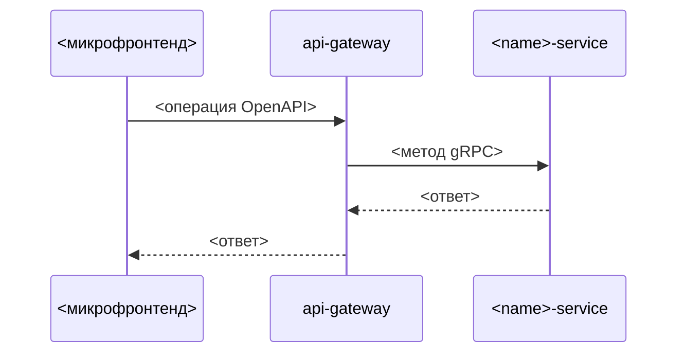

<!--
Шаблон дизайна фичи. Заполняет архитектор (ai/agents/architect.md) по согласованным требованиям.
Дизайн не меняет требования. Раздел, который к фиче не относится, не удаляется: в нём пишется «Не применимо» и почему.
Комментарии шаблона удаляются после заполнения.
-->

# Дизайн: <Название фичи>

## Обзор

<!-- Как фича реализуется в целом, одним абзацем. Какие требования (R…) закрывает. -->

## Затронутые части

<!-- Все сервисы, gateway, микрофронтенды и общие пакеты, которые меняются или появляются. -->

| Часть | Пакет | Изменение |
|---|---|---|
| <сервис или приложение> | `@platform/<name>` | <новый / изменяется: что именно> |

## Взаимодействие

<!--
Последовательность вызовов для каждого основного сценария: frontend → gateway → сервисы → очереди → внешние системы.
Для сложных сценариев — диаграмма Mermaid.
-->

### Сценарий: <название> (R1)

1. <шаг>
2. <шаг>

## Контракты

<!-- Новые и изменённые операции. Ссылки на файлы в api/. Ломающие изменения — с пометкой и планом перехода. -->

### OpenAPI

| Операция | Файл | Изменение | Требования |
|---|---|---|---|
| `<METHOD> <path>` | `api/openapi/<name>.yaml` | <новая / изменена: что> | R1 |

### gRPC

| Метод | Файл | Изменение | Требования |
|---|---|---|---|
| `<Service>.<Method>` | `api/proto/<service>/v1/<file>.proto` | <новый / изменён: что> | R1 |

### События

| Событие | Кто публикует | Кто слушает | Данные |
|---|---|---|---|
| `<name>` | `<service>` | `<service>` | <поля> |

**Ломающие изменения:** <нет / что ломается, кто потребители, как переходим>

## Данные

<!-- Изменения схемы каждого сервиса отдельно. Инварианты. Миграция существующих данных. -->

### `<name>-service`

| Сущность | Поля | Изменение |
|---|---|---|
| <сущность> | <поля и типы> | <новая / изменена> |

- **Инварианты:** <что всегда должно быть верно>
- **Миграция данных:** <нужна ли, как, обратима ли>

## Согласованность и сбои

<!-- Что происходит при сбое на каждом шаге: повтор, идемпотентность, компенсация. Особенно — операции, затрагивающие несколько сервисов. -->

| Шаг | Сбой | Поведение |
|---|---|---|
| <шаг> | <что может сломаться> | <повтор / компенсация / ошибка пользователю> |

## Feature toggles

| Флаг | Что включает | Где проверяется | Когда удаляется |
|---|---|---|---|
| `<name>` | <поведение> | <gateway / сервис / микрофронтенд> | <условие> |

## Безопасность

- **Доступ:** <какие роли что могут; где проверяется>
- **Изоляция компаний:** <как гарантируется>
- **Персональные данные:** <какие, где хранятся, что не логируется>

## Наблюдаемость

- **Метрики:** <бизнес- и технические метрики фичи>
- **Логи:** <значимые события>
- **Алерты:** <условия>

## Отличия от прототипа

<!-- Только при переносе. Что устроено иначе, чем в prototype/, и почему. -->

| В прототипе | В платформе | Почему |
|---|---|---|
| <устройство> | <устройство> | <причина> |

## Риски и решения

<!-- Риски дизайна и как они снижаются. Ссылки на ADR. -->

- <риск> — <как снижаем>
