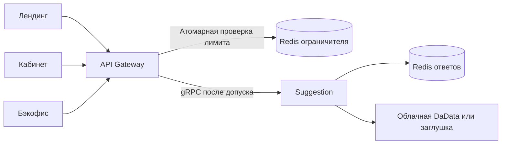

# ADR 0004. Suggestion на DaData и распределённое ограничение запросов в Gateway

## Контекст

Человек согласовал [требования 003-suggestion-service](../../features/003-suggestion-service/requirements.md): четыре вида подсказок, доступ с сессией и без неё, подключение к лендингу, кабинету и бэкофису, настраиваемые 5 RPS на пользователя. Поиск работает со строками от 3 до 150 символов после обрезки пробелов по краям и выдаёт до 10 вариантов в порядке источника. Успешные ответы временно хранятся 24 часа по умолчанию.

Основа решения — предложенный ранее ADR из ветки `chore/adr-suggestion-service`, коммит `a194519`, путь `specs/architecture/adr/0002-suggestion-service.md`. Человек разрешил использовать его как вводные, но это не было принятием ADR. Исходный номер 0002 занят в `develop` ADR дизайн-системы. Номер 0003 используется для API Gateway в ветке `chore/api-gateway`. Поэтому текущее предложение оформляется как ADR 0004; исходный `proposed` не является принятым решением и не включается в `supersedes`.

Требования уточнили исходное предложение:

- сессия необязательна;
- дополнительных фильтров и пользовательского размера выдачи нет;
- внутренняя DaData пока является синтетической заглушкой с интерфейсом облачной интеграции;
- ограничение применяется суммарно по видам подсказок и приложениям, на всех экземплярах Gateway;
- отказ ограничителя не открывает неограниченный доступ к DaData;
- Redis с ответами — необязательная зависимость поиска, а Redis с состоянием ограничения — обязательная зависимость допуска запроса.

Новый сервис, добавление Redis-клиента и изменение общей обработки запросов Gateway требуют ADR. Человек принял этот документ в обсуждении фичи сообщением «adr 0004 согласовано»; статус `accepted` зафиксирован по этому решению. Дизайн, задачи и контракты пишутся после его принятия.

## Варианты

### Размещение интеграции

#### Вариант А. Отдельный `suggestion-service`

- **Плюсы:** интеграция, ключи и справочные данные изолированы; Gateway не содержит бизнес-правил поиска; три приложения используют один сервис.
- **Минусы:** дополнительный gRPC-переход, отдельный процесс и образ.

#### Вариант Б. Интеграция в Gateway

- **Плюсы:** меньше процессов и сетевых переходов.
- **Минусы:** интеграция и кеширование справочных данных попадают в Gateway, что нарушает его согласованную границу ответственности.

### Учёт ограничений

#### Вариант А. Счётчики в памяти экземпляра Gateway

- **Плюсы:** не нужна сетевая зависимость на пути допуска запроса.
- **Минусы:** лимит умножается на число экземпляров, сбрасывается при перезапуске; не выполняет R8.6.

#### Вариант Б. Единое состояние в Redis и атомарный допуск

- **Плюсы:** общий лимит по всем экземплярам и приложениям, явное поведение при отказе, совместная проверка нескольких ограничений.
- **Минусы:** сетевой вызов на каждый запрос подсказок, зависимость от доступности Redis; при нескольких IP нужна инфраструктурная защита.

### Идентификация клиента без сессии

#### Вариант А. Идентификатор из cookie или произвольного заголовка

- **Плюсы:** позволяет различать браузеры за одним сетевым адресом.
- **Минусы:** удаление или замена значения даёт новый лимит; непригоден как единственная защита публичного API, противоречит R8.8.

#### Вариант Б. Доверенный сетевой адрес плюс подтверждённый пользователь

- **Плюсы:** cookie не является основанием нового лимита; запросы пользователя с нескольких адресов можно ограничить совместно, когда доступна подтверждённая сессия.
- **Минусы:** пользователи за одним NAT делят сетевой лимит; распределённый поток с множества адресов нельзя остановить только этим механизмом.

### Redis-клиент

#### Вариант А. Пакет `redis` (node-redis)

- **Плюсы:** документированный Redis-клиент для Node.js; один клиент для кеша и атомарных операций ограничения, без библиотеки общего назначения для rate limiting.
- **Минусы:** новая явная зависимость стека; её поведение при разрыве связи и повторном подключении нужно проверить интеграционно.

#### Вариант Б. `ioredis`

- **Плюсы:** альтернативный клиент экосистемы Redis, может использоваться отдельно от BullMQ.
- **Минусы:** наличие BullMQ в стеке не делает его транзитивный клиент разрешённым прямым API платформы; всё равно нужны явная зависимость, обёртка и проверки отказов. Преимуществ для текущих двух сценариев не установлено.

## Решение

Предлагаются отдельный `suggestion-service`, выбор источника при запуске и распределённый ограничитель в Gateway на Redis через пакет `redis`.

### Границы сервиса и приложений

- Пакет сервиса — `@platform/suggestion-service`, каталог `server/apps/suggestion-service/`.
- Сервис отвечает за нормализацию строки, бизнес-валидацию, получение справочных вариантов, ограничение и порядок выдачи, временное хранение ответов. PostgreSQL, Prisma и постоянной истории запросов у него нет.
- Правило собственной базы применяется к сервисам, которые сохраняют бизнес-данные. Этот сервис не создаёт пустую базу ради соответствия шаблону.
- Gateway отвечает за внешний контракт, допуск и транспорт. Он не хранит ответы подсказок и не обращается к DaData.
- Приложения-потребители контрактов именуются `landing`, `cabinet`, `backoffice`. Их OpenAPI находятся соответственно в `api/openapi/landing.yaml`, `cabinet.yaml`, `backoffice.yaml`.
- Во всех трёх контрактах будут описаны четыре операции подсказок. Повторяющиеся схемы и определения операций используют общие локальные ссылки внутри `api/`; отдельный внешний API «сервиса подсказок» не создаётся.
- Регистрация API этих трёх реальных потребителей не создаёт frontend-host или module в этой поставке. Их интерфейсы и дальнейшие границы разрабатываются отдельно.
- Публичны только явно перечисленные операции подсказок и уже установленные операции флагов. Другие операции кабинета и бэкофиса не становятся публичными.

### Источники

- Порт источника находится в `application/ports/`, адаптеры — в `infrastructure/`. Формат DaData не выходит за границы адаптера.
- Облачная интеграция использует встроенный `fetch`, JSON и настроенный HTTPS-адрес; SDK DaData не вводится. Ключ и адрес задаются окружением, клиент не выбирает их в запросе.
- Выбор `SUGGESTION_PROVIDER` выполняется при старте: `dadata-cloud`, `dadata-onprem-stub`, `stub`. Название `dadata-onprem-stub` не позволяет принять синтетическую реализацию за готовую внутреннюю интеграцию.
- `stub` — локальные синтетические данные. `dadata-onprem-stub` — отдельный режим с синтетической реализацией облачного протокола внутри инфраструктуры сервиса; внешней сети и ключей не требует. В обоих режимах доступны все четыре вида, формат ответа сервиса одинаков.
- Реальная внутренняя DaData не подключается без её документации и отдельного изменения дизайна. Заглушки не заменяют реальные источники в production: такие режимы при `NODE_ENV=production` запрещены проверкой конфигурации.
- Бюджет внешнего вызова — 1500 мс по умолчанию с учётом оставшегося дедлайна; отмена распространяется из Gateway до `fetch`. Автоматических повторов и переключения источника нет.

### Распределённый ограничитель

- Порт допуска запросов находится в Gateway; состояние — в выделенном Redis ограничителя. Его могут использовать все экземпляры Gateway одного окружения.
- Алгоритм — скользящий журнал за последние 1000 мс. Допуск и обновление состояния выполняются атомарным Lua-скриптом с временем Redis, а не локальными часами разных Gateway. Скрипт очищает просроченные события и проверяет ограничения до записи принятого запроса. Отклонённые запросы не продлевают запрет бесконечно.
- Значение `SUGGESTION_RATE_LIMIT_RPS` — положительное целое, по умолчанию 5. Меняется через env с согласованным применением на всех Gateway, без пересборки. Динамического UI и постоянного флага Unleash нет.
- Ключи не включают приложение или вид: переход на другой маршрут не создаёт новый лимит. Повтор запроса, ответ из кеша и пустой ввод учитываются до выполнения поиска.
- Сетевой лимит обязателен для всех запросов подсказок и составляет настроенный RPS на доверенный IP. Если есть подтверждённая сессия, дополнительно применяется такой же лимит на пользователя независимо от его IP. Проверки и расходование обоих лимитов атомарны.
- Оба ограничения используют общее состояние во всех трёх приложениях. Подтверждённые идентификаторы пользователей разных областей аутентификации разделяются по области доверия, чтобы совпадение строк ID не объединяло разные учётные записи; клиент эту область не задаёт.
- При отсутствии реализованной аутентификации запрос проходит как посетитель под сетевым лимитом. Переданные клиентом `Authorization`, cookie, `x-user-id` и другие идентификаторы не являются подтверждением сессии.
- Сетевой лимит сохраняется после входа, выхода и удаления cookie. Это препятствует получению нового сетевого бюджета простой сменой режима доступа. Изменение реального сетевого адреса остаётся ограничением этой модели.
- IPv4-mapped IPv6 нормализуется до IPv4. IPv6 учитывается по полному нормализованному адресу; ограничения подсетей в требованиях не заданы. Их введение при злоупотреблениях требует отдельного решения, поскольку затрагивает группы пользователей.
- По умолчанию используется адрес TCP-соединения. Заголовки пересылки учитываются только от явно разрешённых инфраструктурных прокси; доверие всем прокси или произвольному первому `X-Forwarded-For` запрещено. Публичный обход доверенного reverse proxy должен быть закрыт окружением.
- IP и подтверждённые ID представлены в Redis ключами HMAC-SHA-256 с общим секретом окружения. Короткие сроки жизни записей ограничены окном учёта. Сырые адреса, ID, ключи и строки поиска не попадают в диагностические сообщения.
- При превышении ограничения Gateway отвечает 429; при невозможности проверить его — 503 без обращения в Suggestion. Очереди запросов для последующего воспроизведения и неограниченного локального fallback нет.
- Первая топология — один авторитетный Redis primary для ограничения; Redis Cluster не заявляется. Возобновление при потере состояния выполняется с запретом допуска как минимум на одно полное окно, чтобы перезапуск хранилища не выдавал дополнительный бюджет внутри текущей секунды. Процедура проверки готовности и восстановления фиксируется в дизайне.

**Следствие для NAT, требующее принятия этого ADR:** несколько пользователей с одним доверенным внешним IP делят 5 RPS сетевого бюджета, даже если у них разные сессии. Пользовательский лимит не гарантирует каждому из них независимую пропускную способность. Это предлагаемая дополнительная защита публичного доступа; ослабление сетевого лимита или другой порог нужно согласовать до дизайна.

### Временное хранение ответов

- Успешные ответы, в том числе пустые результаты поиска в источнике, сохраняются на 86400 секунд по умолчанию; TTL настраивается согласно исходным вводным. Пустой и короткий ввод не требуют источника и записи результата.
- Ключ содержит версию модели, выбранный режим источника, отпечаток его адреса/конфигурации справочника, вид и нормализованную строку, представленные безопасным хешированием. Ключи не содержат исходную строку. Режимы заглушки, облака и будущей внутренней системы не используют ответы друг друга.
- Ошибки не кешируются; после истечения TTL старые ответы не выдаются. После записи нового ответа TTL не продлевается простым чтением.
- При отказе Redis ответов сервис продолжает обращаться к источнику под ограничением Gateway; отказ записи кеша не превращает уже успешный поиск в ошибку.
- Redis ответов отделён от Redis ограничителя по процессу/экземпляру и конфигурации, а не только по номеру логической базы. Разные роли отказа и потребление памяти не должны отключать друг друга. Локально это два контейнера Redis из уже используемого образа; существующий Redis окружения для других возможностей не переназначается.
- Временное хранилище ответов работает без AOF/RDB и дисковых резервных копий: иначе 24-часовой TTL не ограничивает срок сохранности копий персональных данных. Недостаток места может приводить к вытеснению кеша; механизм ограничения не использует политику вытеснения действующих счётчиков.

### Зависимости и эксплуатация

- Добавляется одна runtime-библиотека для Redis — пакет `redis`. Общая инфраструктурная библиотека не создаётся до появления повторяющегося API: Gateway и Suggestion используют отдельные адаптеры своих портов. Ни один не импортирует код другого приложения.
- Внутренний gRPC доступен только Gateway в приватной сети; отдельного прямого внешнего входа в Suggestion нет. Проверка сетевого допуска не заменяется доверием пользовательскому заголовку.
- Публичные запросы используют тело POST; строка не попадает в URL и логи. Конкретные пути, RPC и состав полей будут определены в контрактах после принятия ADR.
- Для Suggestion готовность определяется локальной инициализацией; DaData и необязательный кеш ответов не снимают его с трафика. Это уточняет противоречивые вводные исходного ADR о проверке Redis при одновременном требовании работы без кеша.
- Отказ ограничителя блокирует операции подсказок, а не все операции Gateway. Его healthcheck сохраняет правила технической основы Gateway; работоспособность ограничения проверяется отдельно.
- Минимальные диагностические события: источник недоступен, ограничитель недоступен, кеш недоступен. Нельзя писать отдельную неограниченную запись на каждый отклонённый атакующий запрос; в дизайне задаются агрегация и ограничение потока диагностики.
- Метрики и алерты проектируются с учётом ещё не принятого общего стека наблюдаемости: этот ADR не принимает OpenTelemetry/Grafana автоматически.

## Последствия

- Появляется первый справочный сервис без постоянной базы, единый для трёх потребителей.
- Облачная и внутренняя DaData не считаются взаимозаменяемыми в эксплуатации до проверки реального внутреннего протокола.
- Redis становится обязательной зависимостью допуска публичных запросов подсказок; его сбой выражается в 503 этих операций.
- При ограничении по IP общий NAT уменьшает доступную частоту для группы пользователей; это явный компромисс против обхода cookie и смены зоны.
- Хеширование ключей ограничителя не делает их анонимными данными для любых целей: секреты защищаются, сроки хранения ограничиваются, доступ к Redis закрыт.
- Общая квота DaData и гарантированная суммарная пропускная способность не заданы требованиями. При множестве IP индивидуальный лимит не гарантирует сохранность квоты и не защищает от насыщения канала. Настройка reverse proxy, сетевых ограничений, максимальных соединений и размеров запроса входит в дизайн окружения до публичной выкладки.
- В первой поставке не создаются интерфейсы подсказок, система входа, новый сервис аутентификации или пользовательская панель настройки лимита.

## Что нужно обновить

После принятия этого ADR:

- [x] `specs/architecture/tech-stack.md` — DaData, прямой Redis-клиент `redis`, назначение двух отдельных хранилищ.
- [x] `specs/architecture/structure.md` — Suggestion без PostgreSQL, три приложения-потребителя контрактов, размещение портов и адаптеров ограничителя.
- [x] `specs/features/003-suggestion-service/design.md` — полные DTO, маппинг источника, конфигурация, отмена, сроки, алгоритм ограничения и безопасное восстановление, меры на reverse proxy, диагностические события. Документ в `review`, это не приёмка реализации.
- [x] `specs/features/003-suggestion-service/tasks.md` — задачи BE с покрытием всех 41 критериев приёмки; FE-задачи не требуются в текущих границах. Документ в `review`, задачи не выполнены.
- [x] `api/openapi/landing.yaml`, `cabinet.yaml`, `backoffice.yaml` и общие локальные схемы — четыре вида подсказок и обязательные операции флагов.
- [x] `api/proto/suggestion/v1/suggestion.proto` — отдельные типизированные методы для четырёх видов, проверка и генерация.
- [x] `deploy/` — отдельные Redis ответов и ограничителя, без сохранения кеша на диск; настройки RPS, доверенных прокси, HMAC-секретов и источника. Процессы приложений добавляются в T9.
- [ ] Дизайн и задачи технической основы Gateway в ветке `chore/api-gateway` — учесть новые адаптеры без изменения границ готовности и политики публичных операций. Включение изменений этой ветки выполняется отдельно; этот ADR не является разрешением на merge.

## Когда пересмотреть

- Общий NAT делает сетевой лимит неприемлемым для кабинета или бэкофиса.
- Для публичной эксплуатации требуется общий бюджет DaData, другая топология Redis, несколько площадок или гарантия без потери состояния при failover.
- Появился реальный протокол внутренней DaData или другой поставщик справочников.
- Понадобились новые виды, фильтры, переключение провайдера без перезапуска или автоматический fallback.
- Подсказки вызываются другими сервисами напрямую: для них нужно определить независимую границу допуска и расходования квоты.

## Источники технической проверки

- [Официальное руководство Redis по node-redis](https://redis.io/docs/latest/develop/clients/nodejs/) — имя пакета `redis` и применение клиента в Node.js.
- [Официальное описание Lua в Redis](https://redis.io/docs/latest/develop/programmability/eval-intro/) — атомарное исполнение скриптов, включая работу с несколькими ключами. Ограничения конкретного алгоритма и восстановления проверяются интеграционно при реализации.
