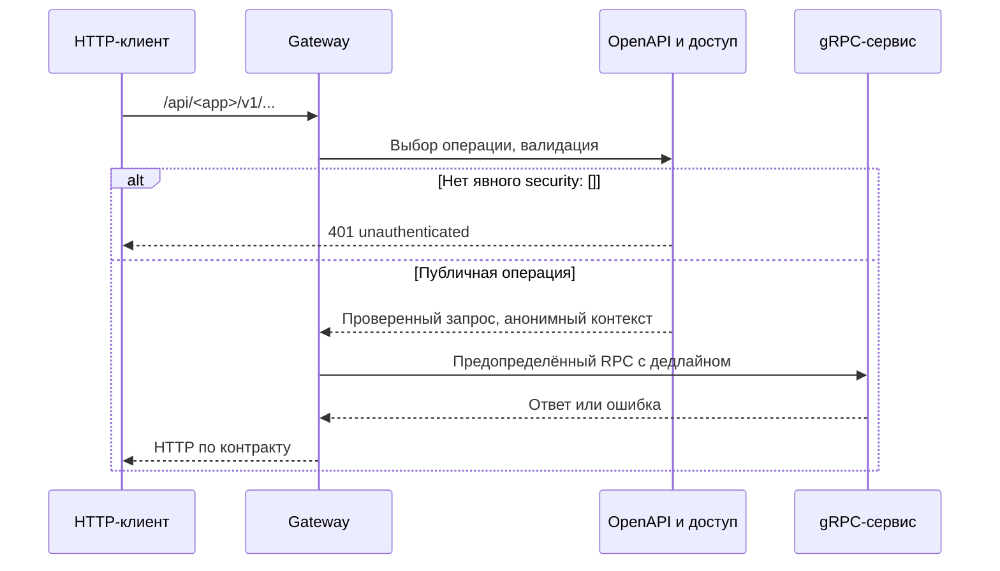

# Дизайн: техническая основа API Gateway

## Обзор

Реализуется [ADR 0003](../../architecture/adr/0003-api-gateway.md), принятый человеком 2026-11-17: gateway на NestJS с явным ExpressAdapter, runtime-валидацией исходного OpenAPI и gRPC-клиентами. Это инфраструктурная работа без требований аналитика, по разделу «Работа вне фичи» [SDD](../../../ai/rules/sdd.md), по образцу `001-feature-flags`. Источник технических критериев `K1…K12` — ADR; они перечислены в конце документа и связаны с [задачами](tasks.md).

Первая поставка предоставляет только технические HTTP/gRPC healthcheck. Реестра приложений, бизнес-сервисов и операций входа пока нет. Подключаемые механизмы маршрутизации, доступа, флагов и gRPC проверяются на тестовых контрактах. Дизайн не разрешает создавать фиктивное приложение или открывать закрытые операции для демонстрации.

## Затронутые части

| Часть | Пакет / каталог | Изменение |
|---|---|---|
| Gateway | `@platform/api-gateway`, `server/apps/api-gateway/` | новый пакет |
| Конфигурация | `@platform/config`, `server/shared/config/` | новый общий пакет |
| Логи | `@platform/logger`, `server/shared/logger/` | новый общий пакет |
| Healthcheck | `@platform/health`, `server/shared/health/` | новый общий пакет |
| Контракты | `@platform/api`, `api/` | технический OpenAPI healthcheck и стандартный unary gRPC healthcheck |
| Генерируемые gRPC-типы | `@platform/contracts` | генерация healthcheck и копирование proto существующими скриптами |
| Флаги | существующий `@platform/feature-flags` | подключение к gateway, изменения API пакета не нужны |
| Окружение | `deploy/` | после реализации — профиль Compose для gateway и пример переменных |
| Web | — | изменений нет |

## Взаимодействие

### Запуск и healthcheck (K1, K2, K3, K10)

1. `main.ts` читает и валидирует конфигурацию; ошибка завершает запуск без вывода значений env.
2. Подключает `@platform/logger`, создаёт NestJS-приложение с ExpressAdapter; автоматические body parser отключены, чтобы порядок обработки определял gateway.
3. Загружает реестр приложений, локальные OpenAPI и валидаторы. Инициализирует HTTP/gRPC healthcheck и клиент Unleash, не ожидая доступности Unleash.
4. Открывает порты, переводит локальное состояние readiness в `ready` только после завершения инициализации. Пустой реестр приложений допустим.
5. HTTP live возвращает `200 {"status":"ok"}`. HTTP ready возвращает тот же ответ, если состояние `ready`, иначе `503 {"code":"not_ready","message":"Сервис не готов принимать запросы"}`. Ответы имеют `Cache-Control: no-store`.
6. Unary `grpc.health.v1.Health/Check` возвращает `SERVING` только в состоянии `ready`, иначе `NOT_SERVING`. Принимаются имя `""` и `"api-gateway"`; неизвестное имя — `NOT_FOUND`. Watch не реализуется; стандартный клиент получает `UNIMPLEMENTED`.

Healthcheck обходит выбор приложения, политику сессии и логирование запросов. Ответы не содержат имён зависимостей, адресов или текста ошибок. Недоступность другого сервиса или Unleash не меняет readiness.

### Прикладной запрос — механизм, проверяемый тестами (K4–K9)

В рабочей сборке этого этапа прикладных контроллеров нет. HTTP-конвейер:

1. Генерирует UUID request ID через `node:crypto.randomUUID()`, возвращает `X-Request-Id`; входящий одноимённый заголовок не использует.
2. Определяет приложение по префиксу `/api/<app>` и операцию по методу и шаблону пути. Неизвестные адреса и методы возвращают 404 в общем формате; неявные Express HEAD/OPTIONS не открывают операций. CORS выключен.
3. Запускает ограниченный JSON-parser и валидатор соответствующего документа. Применяет общий бюджет времени с момента приёма запроса.
4. Проверяет явное `security: []` именно на уровне операции. Иначе возвращает 401 до контроллера; отсутствие `security` в документе не делает операцию публичной.
5. Контроллер вызывает зарегистрированный адаптер сервиса или локальный механизм флагов, собирает DTO ответа.
6. Единый нормализатор преобразует ошибки middleware, NestJS и gRPC. На завершении запроса формируется безопасная запись лога.

### Выдача флагов — механизм, проверяемый тестами (K8)

`FeatureFlagsService.evaluate(appId)` берёт имена только из `components.schemas.FeatureFlags.properties` документа выбранного приложения и вызывает существующий `FeatureFlagsClient.isEnabled(name, {})`. Результат — `Record<string, boolean>` с этими именами. Пустая схема возвращает `{}`. Произвольные query-параметры с идентичностью отвергаются валидатором; cookie и заголовки не создают пользовательский контекст.

Контроллер `getFeatureFlags` подключается вместе с реальным приложением и его контрактом. Тестовый модуль регистрирует два синтетических приложения с разными схемами и одинаковым путём `/v1/feature-flags`. Ответ имеет `Cache-Control: no-store`; SDK без кеша возвращает `false`, недоступность Unleash не превращает ответ в ошибку. Новые флаги и записи `deploy/unleash/flags.json` не вводятся.

## Устройство реализации

### Пакеты и зависимости

Все новые пакеты используют существующие пресеты `@platform/server-tooling` и ESM. Общие пакеты экспортируют API из `dist/index.js` и `dist/index.d.ts`, имеют `typecheck`, `test`, `build`. Gateway имеет также `test:integration` и `start` (`node dist/main.js`); сборка не включает тесты. Версии общих NestJS-зависимостей совпадают с workspace, конкретные версии новых разрешённых библиотек фиксируются в lock-файле при реализации.

| Пакет | Runtime-зависимости |
|---|---|
| `@platform/config` | стандартная библиотека Node.js; NestJS для модуля DI |
| `@platform/logger` | `pino`, `nestjs-pino`, `@platform/config`, NestJS и его peer-зависимости |
| `@platform/health` | `@nestjs/common`, `@nestjs/core`, `@nestjs/microservices`, `@nestjs/terminus`, `@platform/contracts`, gRPC runtime из workspace |
| `@platform/api-gateway` | NestJS, `@nestjs/platform-express`, `express`, `express-openapi-validator`, `@nestjs/microservices`, `@grpc/grpc-js`, `@grpc/proto-loader`, `rxjs`, `reflect-metadata`, четыре общих пакета: config, logger, health, feature-flags; `@platform/contracts` |

Redocly используется как существующий инструмент `@platform/api` при подготовке схем; YAML-парсер и генератор OpenAPI из декораторов в gateway не добавляются. OpenTelemetry, Grafana и пакет `observability` остаются отдельным этапом.

### Конфигурация (K1)

`@platform/config` экспортирует `readGatewayConfig(env: Record<string, string | undefined>): GatewayConfig`, `ConfigModule.forRoot({ config })` и DI-токен `GATEWAY_CONFIG`. Объект конфигурации неизменяемый. Функция чистая, сама не читает `process.env`; чтение делает только точка входа. Ошибка содержит список имён неверных переменных без их значений. Модуль не навязывает gateway-конфигурацию другим сервисам: их функции чтения добавляются отдельно.

| Переменная | Значение по умолчанию | Проверка / смысл |
|---|---|---|
| `NODE_ENV` | `development` | `development`, `test`, `production` |
| `APP_VERSION` | `0.0.0` | непустая строка, версия образа |
| `HTTP_HOST` | `0.0.0.0` | IPv4/IPv6-адрес привязки |
| `HTTP_PORT` | `3000` | целое 1…65535 |
| `GRPC_HEALTH_HOST` | `127.0.0.1` | адрес привязки; в контейнерной сети явно `0.0.0.0` |
| `GRPC_HEALTH_PORT` | `50050` | целое 1…65535; при пересекающихся адресах не совпадает с HTTP-портом |
| `HTTP_REQUEST_TIMEOUT_MS` | `10000` | целое 1…2147483647, бюджет операции от приёма запроса |
| `GRPC_CALL_TIMEOUT_MS` | `3000` | целое от 1 до HTTP-бюджета |
| `HTTP_BODY_LIMIT_BYTES` | `1048576` | целое 1…2147483647 |
| `SHUTDOWN_TIMEOUT_MS` | `15000` | целое 1…2147483647, общий бюджет завершения |
| `LOG_LEVEL` | `info` | `debug`, `info`, `warn`, `error`; `debug` запрещён в production |
| `UNLEASH_URL`, `UNLEASH_API_TOKEN` | нет | обязательны, проверяются существующим пакетом флагов |
| `UNLEASH_BACKUP_PATH`, `UNLEASH_REFRESH_INTERVAL_MS` | по ADR 0001 | не переопределять правила существующего пакета |

В `GatewayConfig` — `env`, `version`, `http: {host, port, requestTimeoutMs, bodyLimitBytes}`, `grpc: {healthHost, healthPort, callTimeoutMs}`, `shutdownTimeoutMs`, `logLevel`. Настройки Unleash остаются в существующем пакете и не дублируются в этом объекте. На первом этапе адресов бизнес-сервисов в env нет: реестр клиентов пуст. Конфигурация прокси не вводится; `trust proxy` выключен.

### Реестр OpenAPI и маршрутов (K4, K5)

В `src/openapi/app-registry.ts` экспортируется неизменяемый массив `AppDefinition`: `{ id, documentFile, operations }`. `id` — уникальный kebab-case, документ — локальный артефакт сборки; префикс `/api/${id}` должен совпадать с единственным `servers.url`. В рабочей версии массив пуст. Каждый `OperationBinding` содержит `{ operationId, method, path, controller, handler }`; это ссылки на NestJS-контроллер и его метод, а не имя для загрузки кода из запроса. Для повторяемого `operationId` в разных приложениях ключом служит пара `(appId, operationId)`.

`OpenApiRegistry` предоставляет `resolve(method, pathname)`, `getDocument(appId)`, `getFeatureFlagNames(appId)`. Сопоставление не зависит от порядка регистрации: статический сегмент имеет приоритет над параметром; одинаковые шаблоны с разными именами параметров запрещены. Префикс проверяется по границе сегмента. Декодирование не должно превращать `%2F` в дополнительный сегмент маршрута. Реестр и валидатор должны одинаково трактовать адрес; несовпадение обнаруживается интеграционной проверкой и блокирует приёмку.

До readiness сверяются: валидность OpenAPI 3.1, уникальность регистраций, `operationId`, method/path и реальные маршруты прикладных контроллеров. Лишний контроллер, отсутствующий binding или несовпадение документа — ошибка старта. Технические healthcheck исключаются из реестра приложений и проверяются своим контрактом.

При сборке Redocly `bundle` создаёт локальные JSON-представления документов; исходники и локальные `$ref` также копируются в образ. Все внешние `$ref` запрещены проверкой до вызова bundle, включая вложенные ссылки; локальные пути не выходят из каталога контрактов. Для runtime используется тот же документ, что проверен при сборке; JSON читается стандартной библиотекой. Артефакты не правятся вручную. Тесты пользуются отдельным реестром, передаваемым через DI; env-переключателя на fixtures нет.

### Валидация и доступ (K5, K6)

Для каждого приложения подключается `express-openapi-validator`: `validateApiSpec: true`, `validateRequests: { allowUnknownQueryParameters: false, removeAdditional: false, coerceTypes: false, allErrors: false }`, `validateSecurity: false`, `validateResponses: false`, `operationHandlers: false`, `fileUploader: false`, `ignoreUndocumented: false`. Body parser выполняется до валидатора. JSON-строка вместо числа в теле отвергается; query/path преобразуются по контракту. `additionalProperties: false` в закрытых объектах не позволяет молча удалить лишние свойства.

`PublicOnlyAccessPolicy.assertAllowed(operation)` допускает только явный пустой массив `security` операции. `AnonymousContext` — пустой неизменяемый объект; входящие идентификационные поля игнорируются при построении контекста и никогда не копируются в metadata. Сессии, роли и подмена контекста через env не реализуются. Политика вызывается для каждого прикладного binding и тестируется попыткой обхода через незарегистрированный NestJS-маршрут.

### Ошибки (K7)

`normalizeError(error, operation?)` возвращает `{ status, body: { code, message, details? } }`; общий Express error-handler и NestJS exception filter вызывают эту функцию. Машинные коды бизнес-ошибок разрешены только явным списком в binding операции и при наличии соответствующей схемы ответа. Без такого описания используются безопасные значения из ADR. Произвольные `message` и `details` upstream не пробрасываются.

Точная таблица HTTP/gRPC-статусов — [ADR 0003, «Единые ошибки»](../../architecture/adr/0003-api-gateway.md#единые-ошибки). В том числе неизвестный маршрут — 404, неверный JSON — 400, большой body — 413, неподдерживаемый Content-Type — 415, дедлайн — 503. До завершения аутентификации корректный закрытый запрос получает 401; невалидный может получить 400 до проверки доступа.

Стандартные тексты по кодам: `invalid_request` — «Некорректный запрос»; `unauthenticated` — «Требуется вход»; `permission_denied` — «Недостаточно прав»; `not_found` — «Ресурс не найден»; `conflict` — «Конфликт состояния»; `business_rule_violation` — «Действие нарушает правила»; `payload_too_large` — «Превышен размер запроса»; `unsupported_media_type` — «Неподдерживаемый тип содержимого»; `rate_limit_exceeded` — «Превышен лимит запросов»; `service_unavailable` — «Сервис временно недоступен»; `internal_error` — «Внутренняя ошибка сервера». Для валидации первого этапа `details` отсутствует.

### gRPC и жизненный цикл запроса (K9)

`RequestScope` содержит `requestId`, абсолютный дедлайн, `AbortSignal`; он создаётся один раз для запроса. Бюджет измеряется монотонными часами, а абсолютный gRPC deadline вычисляется из оставшегося времени. gRPC-клиенты создаются один раз на процесс и закрываются при завершении.

`GrpcCallExecutor.execute(call, scope)` ограничивает вызов минимумом остатка HTTP-бюджета и `GRPC_CALL_TIMEOUT_MS`. `call` — функция, создающая unary `ClientUnaryCall`, возвращаемое значение которого можно отменить. Executor владеет таймером, подпиской на сигнал, вызывает `cancel()` и освобождает обработчики после результата. При исчерпанном бюджете новый RPC не отправляется. Клиенты используют `PROTO_LOADER_OPTIONS`; channel retries явно отключены (`grpc.enable_retries: 0`), retry service config не задаётся. Прикладных повторов нет.

По событию прерванного запроса или закрытия ответа до `writableFinished` все незавершённые RPC отменяются. Нормальное завершение чтения HTTP-тела не считается отключением клиента. Передаваемая metadata первого этапа содержит только серверный `x-request-id`; заголовки запроса не копируются. Пустые user/company metadata не создаются.

В обязательной агрегации первая ошибка отменяет остальных участников, HTTP-ответ отправляется один раз. Тестовый RPC и `.proto` для него находятся в `test/fixtures/`, изолированы от рабочего образа; доменного контракта платформы не добавляется.

### Логи и healthcheck (K2, K3)

`@platform/logger` экспортирует `PlatformLoggerModule.forRoot({ service, version, env, level })`, NestJS LoggerService и `RequestLogRecord`. Он использует pino через `nestjs-pino`; автоматическое логирование сырых req/res выключено. `RequestLogRecord` содержит только `requestId`, `appId?`, `operationId?`, `route?`, `method`, `status`, `durationMs`, `code?`. Для неизвестного адреса route/appId отсутствуют; сырой URL не заменяет шаблон. HTTP middleware передаёт уже отобранную запись. Общие поля: timestamp, level, service, version, env, message. Поля trace_id/span_id добавляются только с реальной трассировкой; пустые или случайные значения не создаются.

NestJS и библиотеки направляются в тот же логгер; известные категории событий преобразуются в статические безопасные сообщения. Конфигурационные ошибки логируют только имена полей; ошибки gRPC — код и имя зарегистрированного сервиса; сообщения SDK Unleash — категорию события без raw error и адресов. Тела, query, cookie, токены и произвольные объекты исключений не передаются в логгер. Проверка захватывает stdout и подставляет синтетические секреты во все эти источники.

`@platform/health` экспортирует `HealthModule.register({ serviceName })`, `HealthState` с методами `markReady()`, `beginShutdown()`, `isReady()` и HTTP/gRPC-контроллеры. Начальное состояние — `initializing`; после `beginShutdown()` переход обратно в ready запрещён. `@nestjs/terminus` используется внутри HTTP-проверок, наружу возвращается DTO нашего контракта, а не стандартное тело Terminus. gRPC-контроллер реализует генерируемый `Health` из `@platform/contracts/grpc/health/v1/health`. Стандартные имена proto сохранены; исключения Buf ограничены этим файлом.

### Завершение и поставка (K10–K12)

Единый координатор `ShutdownCoordinator` реагирует на первый SIGINT/SIGTERM; повторный сигнал не запускает второй сценарий. Он переводит readiness в false и закрывает приём новых прикладных операций (503), сохраняя healthcheck живым на время дренирования. Ведёт счётчик текущих операций, ждёт их завершения до общего deadline, отменяет остаток, затем закрывает серверы, каналы и Unleash. Закрытие ресурсов укладывается в тот же бюджет, а не получает дополнительные 15 секунд.

Ошибка остановки SDK Unleash 6.12.2 остаётся принятым риском из `001-feature-flags/T3`: нельзя добавлять глобальный обработчик, подавляющий все `unhandledRejection`. Контролируемое завершение без SDK-сбоя ожидает exit 0; сценарий известного сбоя допускает exit 1, но не зависание и не превышение бюджета. Обновление SDK остаётся задачей исходной фичи.

Dockerfile gateway — многостадийный, Node.js 26, непривилегированный пользователь; runtime содержит dist, production-зависимости, исходные контракты, JSON-артефакты и proto healthcheck. Fixtures и dev-инструменты в runtime отсутствуют. Собственные фоновые сервисы не нужны. HTTP-порт — 3000, внутренний gRPC-health — 50050; последний не публикуется на хост.

При реализации `deploy/docker-compose.yml` получает сервис `api-gateway` в профиле `gateway`: порт `${GATEWAY_HTTP_PORT:-3000}:3000`, адрес Unleash `http://unleash:4242/api`, внутренний bind health `0.0.0.0`, локальный токен из `deploy/.env`. `depends_on` может задавать порядок запуска Unleash без `service_healthy`: его недоступность не блокирует gateway. Docker healthcheck вызывает HTTP ready через встроенный fetch Node.js. В `deploy/.env.example` добавляются переменные из таблицы с комментариями и локальными значениями, без рабочих секретов.

Обычный `pnpm env:up` сохраняет инфраструктурное окружение. Запуск gateway: `docker compose -f deploy/docker-compose.yml --env-file deploy/.env --profile gateway up -d --build --wait`; перед ним нужны `pnpm env:up` и готовый код задачи T12. До реализации Dockerfile Compose-сервис не добавляется.

## Контракты

### OpenAPI

| Операция | Файл | Изменение | Критерий |
|---|---|---|---|
| `GET /health/live` | [gateway-health.yaml](../../../api/operational/gateway-health.yaml) | новая техническая операция, 200/400 | K3 |
| `GET /health/ready` | тот же файл | новая техническая операция, 200/400/503 | K3 |

Обе операции не требуют сессии. Технический документ расположен вне `api/openapi/`, проверяется Redocly, но не создаёт клиент web-приложения. Валидация healthcheck в интеграционных проверках использует этот документ; неизвестные query-параметры получают 400. Иных прикладных OpenAPI-контрактов на этом этапе нет. `getFeatureFlags` проверяется на fixtures и добавляется в рабочий реестр только вместе с реальным приложением.

### gRPC

| Метод | Файл | Изменение | Критерий |
|---|---|---|---|
| `grpc.health.v1.Health.Check` | [health.proto](../../../api/proto/grpc/health/v1/health.proto) | стандартный unary healthcheck; имена и номера полей сохранены | K3 |

`HealthCheckRequest.service` — строка. `HealthCheckResponse.status`: UNKNOWN=0, SERVING=1, NOT_SERVING=2, SERVICE_UNKNOWN=3. В наших ответах Check используются SERVING/NOT_SERVING, неизвестный service — gRPC NOT_FOUND. Контракт не объявляет Watch/List. Источник wire-совместимости — стандартный [gRPC healthcheck](https://grpc.io/docs/guides/health-checking/).

### События

Не применимо: очереди и межсервисные события в каркас не входят.

**Ломающие изменения:** нет, потребителей ещё нет. Новый префикс API применяется при создании первого приложения. Новые статусы 413/415 фиксируют ошибки HTTP-конвейера.

## Данные

Не применимо: у gateway нет бизнес-хранилища и миграций. В памяти находятся реестр контрактов, счётчик запросов и состояние жизненного цикла. Кеш Unleash и backup управляются существующим пакетом по ADR 0001. Сессии не хранятся и не создаются.

## Согласованность и сбои

| Шаг | Сбой | Поведение |
|---|---|---|
| Конфигурация / контракт | Неверный env, отсутствующий документ, конфликт маршрутов | запуск завершается; ready не становится успешным |
| Валидация | Невалидный запрос | 400/413/415, upstream не вызывается |
| Доступ | Операция не помечена публичной | 401, upstream не вызывается |
| gRPC | Таймаут, недоступность, поздний ответ | 503, отмена, без повторов и двойного HTTP-ответа |
| Агрегация | Одна обязательная часть не получена | ошибка запроса, отмена остальных вызовов |
| Клиент | Отключился до завершения | отмена вызовов, запись завершения без попытки ответить в закрытый сокет |
| Unleash | Недоступен | кеш или false, ready не меняется |
| Завершение | Запрос не завершён в бюджет | отмена, закрытие ресурсов; известный риск SDK отражён выше |

Бизнес-транзакций, компенсаций и локального кеша идемпотентности нет.

## Feature toggles

Новые флаги не вводятся: каркас не меняет существующий пользовательский сценарий. Механизм выдачи следует ADR 0001; его критерий — K8. Изменения схем `FeatureFlags` и `deploy/unleash/flags.json` не требуются.

## Безопасность

- **Доступ:** только явное `security: []`; healthcheck — отдельный разрешённый технический маршрут. Валидация не заменяет политику доступа.
- **Изоляция компаний:** контекст анонимный, идентичность из HTTP не принимается; операции компаний в этой поставке отсутствуют.
- **Персональные данные:** не собираются, в fixtures — синтетические значения. Безопасность логов проверяется захватом stdout.
- **Сеть:** CORS и доверие к forwarded-заголовкам выключены; адреса upstream не задаются запросом. gRPC-health изолирован сетью окружения. TLS, сессии и модель доверия gateway → сервис — отдельный этап до появления закрытых операций.
- **Ограничения:** размер тела, бюджет обработки и дедлайн RPC проверяются на границах. Загрузка файлов и произвольных схем не включена.

## Наблюдаемость

- **Логи:** завершение прикладных запросов, старт, ошибка инициализации, начало/окончание дренирования; только безопасные поля. Healthcheck исключён.
- **Метрики:** экспорт RED и runtime-метрик отложен вместе с утверждением стека наблюдаемости. Границы будущей инструментации — HTTP request scope и GrpcCallExecutor; высококардинальные requestId/URL не станут labels.
- **Трассировки:** сквозной контекст OpenTelemetry пока не создаётся и не имитируется request ID.
- **Алерты:** каналы и пороги — инфраструктура стенда; в этой поставке сигнал готовности — healthcheck.

## Риски и решения

- [ADR 0003](../../architecture/adr/0003-api-gateway.md) определяет Express и границы каркаса; Fastify и NodeAdapter рассмотрены.
- Поддержку нужной части OpenAPI 3.1 и порядок ошибок Express/NestJS подтверждает T6 на версиях workspace. Несовместимость — блокер реализации, а не повод молча поменять библиотеку.
- Стандартный gRPC healthcheck требует локальных исключений именования Buf; бизнес-proto остаются под STANDARD.
- Известная ошибка shutdown Unleash не исправляется подавлением ошибок процесса; отслеживается в исходной фиче.
- Проверки реализации выполняются на Node.js 26. Среда подготовки спецификации использует Node.js 24; проверка документов на ней не подтверждает runtime-совместимость gateway.

## Критерии готовности

| Критерий | Проверяемый результат |
|---|---|
| K1 | Конфигурация читает перечисленные env, проверяет диапазоны и зависимости; ошибки не раскрывают значений; неверный конфиг не запускает gateway |
| K2 | Все логи gateway и подключённых библиотек проходят через общий логгер; синтетические секреты из body/query/cookie/env/upstream не попадают в stdout |
| K3 | HTTP/gRPC healthcheck соблюдают контракты, начальное и завершающее состояния; независимы от Unleash и upstream |
| K4 | Пустой реестр допускает только healthcheck; два тестовых приложения с одинаковыми путями изолированы; неоднозначность и несоответствие контроллеров блокируют старт |
| K5 | Runtime-валидация OpenAPI 3.1 проверяет body/path/query/headers, UUID и границы; не исправляет JSON и не удаляет лишние свойства; срабатывают 413/415 |
| K6 | Только явное security: [] открывает операцию; все остальные закрыты с 401; поддельные заголовки/cookie не меняют контекст и metadata |
| K7 | Ошибки Express/NestJS/gRPC соответствуют таблице ADR и безопасным текстам; HTML, стеки и сообщения upstream наружу не выходят |
| K8 | Выдача флагов изолирована по схемам приложений, без лишних свойств и персонализации; no-store; кеш/false при недоступности Unleash |
| K9 | Дедлайн ограничен общим бюджетом; отключение клиента и ошибка агрегации отменяют вызовы; число попыток всегда одно; обработчики освобождаются |
| K10 | SIGINT/SIGTERM снимает readiness, дренирует и отменяет запросы в общий бюджет; повторный сигнал не запускает второй сценарий; известный SDK-сбой не скрывается |
| K11 | Типы healthcheck генерируются; lint/generate/breaking проходят; реальных Pact-потребителей ещё нет, этот факт отражён явно; проверки fixtures не выданы за Pact |
| K12 | Образ на Node.js 26 запускается без fixtures и dev-инструментов; HTTP health доступен, gRPC порт не публикуется; профиль Compose работает с недоступным Unleash |
