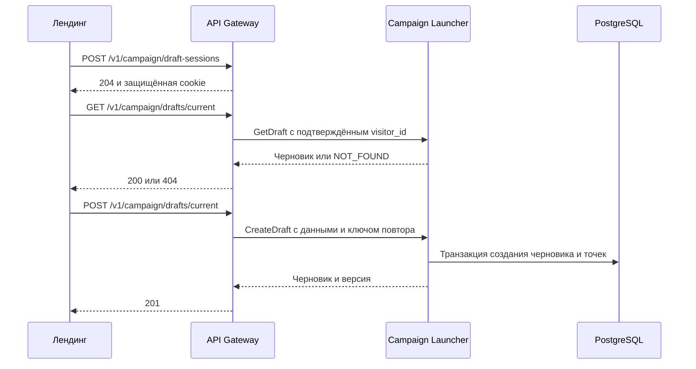

# Дизайн: черновик рекламной кампании и данные бизнеса

## Обзор

Campaign Launcher владеет черновиком и данными первого шага по [R1–R5](requirements.md). Gateway — единственный внешний вход. Оффер и параметры аудитории получат отдельные операции записи по тому же идентификатору заявки, когда появятся требования к этим шагам. Границы сервиса определены в [ADR 0005](../../architecture/adr/0005-campaign-launcher.md).

## Затронутые части

| Часть | Пакет | Изменение |
|---|---|---|
| Campaign Launcher | `@platform/campaign-launcher-service` | NestJS, gRPC, собственная PostgreSQL через Prisma и сценарии черновика |
| Gateway | `@platform/api-gateway` | Маршруты лендинга и кабинета, гостевая cookie, подтверждённый контекст автора и клиент gRPC |
| Suggestion | `@platform/suggestion-service`, `@platform/api-gateway` | Дополнительные необязательные сведения организации или ИП |
| Лендинг и личный кабинет | `@platform/landing-campaign-launcher`, `@platform/app-campaign-launcher` | Модули первого шага в составе соответствующих host. Используют клиент API от host. Создание самих host и навигация кабинета требуют клиентской спецификации |

## Взаимодействие

### Посетитель и первое сохранение (R1, R2, R4)

1. Открытие гостевой сессии подтверждает имеющуюся cookie или выдаёт новую. Операция не создаёт черновик. При повторном открытии с действующей cookie ключ посетителя сохраняется.
2. Только последующий запрос с действующей cookie получает гостевой контекст. Если браузер её не сохранил, Gateway отвечает 401 до вызова Campaign Launcher. Форма продолжает работать в памяти вкладки.
3. Клиент сохраняет новый черновик, когда ИНН и телефон валидны. У существующего черновика клиент заменяет снимок бизнес-данных через PUT с последней полученной версией. Переход к следующему шагу контролируется фронтендом по R4.1. Пока посетитель очищает ИНН или телефон, клиент не отправляет сохранение.
4. При удалении сервис удаляет заявку и её точки. Gateway очищает гостевую cookie в успешном ответе.

### Авторизованный пользователь (R1, R2, R3)

- Базовый путь страниц личного кабинета — `/app`. Лендинг и кабинет используют API Gateway с общим префиксом `/api`. Прямой переход описан в [ADR 0006](../../architecture/adr/0006-unified-api.md).

- Gateway требует подтверждённую сессию и передаёт в gRPC только полученные из неё `userId` и `companyId`. При создании Campaign Launcher получает значения профиля по этим идентификаторам через порт профиля. Значения, действительно полученные из профиля, имеют приоритет над входными значениями и сохраняются в снимке вместе с признаком блокировки. Для отсутствующих значений используются данные запроса. Источник профиля и вывод начального предзаполнения в форме зависят от контракта профиля кабинета.
- Черновик кабинета создаётся отдельной операцией. Для чтения, изменения и удаления используются его UUID и подтверждённая идентичность автора в компании. Выбор заявки в кабинете относится к клиентской спецификации.
- Сервис валидирует заполненные значения после применения профиля. На обновлении попытка изменить или очистить заблокированное значение отклоняется целиком. Повторное открытие отдаёт сохранённый снимок и признаки блокировки.

### Подсказки по ИНН (R5)

- Фронтенд вызывает существующий Suggestion через Gateway и применяет ответ, только если ИНН ответа совпадает с актуальным ИНН формы. Новый результат заменяет поля, которые заполняются справочником, с учётом блокировок профиля. Непришедшие дополнительные сведения по новому ИНН не переносятся от прежнего ИНН.
- При наличии адреса из реестра фронтенд передаёт его как реквизит и как адрес точки, используя этот же адрес для названия по умолчанию. Название можно отредактировать. Campaign Launcher сохраняет полученный снимок и список точек вместе.
- Suggestion отдаёт дополнительные поля только при наличии однозначного значения у провайдера. В частности, код ОКВЭД сам по себе не становится текстом сферы деятельности. Перед включением автоматического заполнения проверяется фактическое покрытие полей адаптерами. Введённые пользователем валидные данные можно сохранить при недоступности справочника.

## Контракты

| OpenAPI | Операции | Требования |
|---|---|---|
| [Общий API, гостевые операции](../../../api/openapi-preview/platform.yaml) | POST `/v1/campaign/draft-sessions`, POST/GET/DELETE `/v1/campaign/drafts/current`, PUT `/v1/campaign/drafts/current/business-data` | R1, R2, R4, R5 |
| [Общий API, операции автора](../../../api/openapi-preview/platform.yaml) | POST `/v1/campaign/drafts`, GET/DELETE `/v1/campaign/drafts/{draftId}`, PUT `/v1/campaign/drafts/{draftId}/business-data` | R1–R5 |
| [Подсказки организаций](../../../api/openapi-shared/suggestions.yaml) | В ответе существующей операции добавляются необязательные `fullName`, `okved`, `businessName`, `industry`, `city`, `website` | R5 |

| gRPC | Изменение | Требования |
|---|---|---|
| [CampaignLauncherService](../../../api/proto/campaign-launcher/v1/campaign_launcher.proto) | `CreateDraft`, `GetDraft`, `UpdateDraftBusiness`, `DeleteDraft` | R1–R5 |
| [SuggestionService](../../../api/proto/suggestion/v1/suggestion.proto) | Необязательные дополнения к `PartySuggestion`. ИНН, КПП, ОГРН/ОГРНИП и адрес продолжают использовать существующие поля | R5 |

Gateway сверяет каждую операцию рабочего OpenAPI с зарегистрированным обработчиком при старте. Поэтому операции Launcher подготовлены в кандидатном контракте `api/openapi-preview/platform.yaml`. Задача T8 в одной поставке переводит подсказки и флаги на общий префикс и удаляет прежние префиксы. В задачах T4 и T5 архитектор добавляет операции Launcher в рабочий `api/openapi/platform.yaml` и генерирует типы. Операции публикуются вместе с обработчиками. Кандидатный контракт проверяется отдельно через Redocly.

События не требуются. Операции Launcher новые. Перенос существующих путей подсказок и флагов в T8 меняет HTTP-контракт. По ADR 0006 внешних потребителей ещё нет, поэтому старые пути удаляются в той же поставке. Вход PUT — полный снимок бизнес-данных. Отсутствующий необязательный атрибут очищает редактируемое поле. Пустой список удаляет точки. ИНН, телефон и список передаются при каждом сохранении. Сайт должен быть абсолютным HTTP(S) URL с доменным именем. Домен проверяется после разбора URL, пользователь и пароль в URL отклоняются. Email проверяется через формат OpenAPI и правило `mailbox@domain1.domain`. Значения только из пробельных символов не проходят доменную проверку.

## Данные

Campaign Launcher использует Prisma как ORM для своей PostgreSQL. Схема сервиса лежит в `server/apps/campaign-launcher-service/prisma/schema.prisma`, миграции — в `prisma/migrations/`. Сгенерированный клиент применяется только в `src/infrastructure/prisma/`. Репозиторий преобразует модели Prisma в доменные сущности. Запись черновика и его точек выполняется в одной транзакции Prisma.

| Сущность | Поля и ограничения |
|---|---|
| `campaign_drafts` | UUID, автор, компания для авторизованного автора, статус `draft`, версия, даты создания и изменения, типизированные поля бизнеса и справочные сведения, список заблокированных полей, UUID ключа создания и отпечаток канонического запроса |
| `customer_locations` | Порядковый номер в черновике, название, адрес, FK черновика с каскадным удалением |

Источник владения взаимоисключающий: гостевой идентификатор или пара пользователя и компании. Уникальный индекс для гостевого автора допускает один черновик. Уникальный индекс по владельцу и ключу создания защищает повтор POST. ИНН хранится строкой для сохранения ведущих нулей. Версия стартует с 1 и увеличивается при обновлении. Запись черновика и замена списка точек проходят одной транзакцией. Миграция создаёт новые таблицы в базе сервиса, переноса существующих данных нет. Удаление уничтожает данные заявки и её точек, сохраняя профиль пользователя. Политика хранения резервных копий зависит от общих правил обращения с персональными данными.

## Согласованность и сбои

| Ситуация | Поведение |
|---|---|
| Повтор POST с тем же ключом и телом | Возвращается текущая запись ранее созданного черновика с 201, пока запись существует. Сравнение запроса по сохранённому отпечатку. Отличающееся тело или второй гостевой черновик дают 409 |
| Позднее сохранение из другой вкладки | Проверка версии в той же транзакции. При устаревшей версии 409 `stale_draft_revision`. Клиент перечитывает черновик и даёт пользователю повторить действие |
| Некорректный запрос или изменение поля профиля | 400 `invalid_request` при нарушении OpenAPI, 422 `invalid_business_data` при нарушении бизнес-правила. Данные остаются прежними |
| Чужая или отсутствующая заявка | 404 `draft_not_found`. Повтор DELETE не восстанавливает удалённые данные |
| Suggestion недоступен | Пользователь может сохранить валидный ввод без новых справочных сведений |
| Недоступна база, сервис или обязательный источник профиля при создании в кабинете | 503 `service_unavailable`. Частичной записи нет. Клиент повторяет создание с прежним ключом |
| Потеря cookie | Гостевой доступ не восстанавливается в первом шаге. Новый гостевой контекст не даёт прав на прежний черновик |

## Feature toggles

Не применимо. Фича не добавляет флагов. Общая операция платформы `GET /api/v1/feature-flags/{web-app}` описана в кандидатном контракте и подключается в T8.

## Безопасность

- Гостевая cookie `campaign_visitor` содержит подписанное сервером значение с криптографически случайным идентификатором и сроком действия 30 дней. Флаги `HttpOnly`, `Secure`, `SameSite=Lax`, без `Domain`, с Path `/api/v1/campaign`. Для браузера Gateway доступен на том же origin по общему префиксу `/api`. Секрет подписи передаётся через конфигурацию Gateway. Сервис принимает доверенный гостевой идентификатор только от Gateway. После удаления черновика закрывается browser-сессия, доступ к удалённой записи невозможен.
- Для изменяющих запросов Gateway требует точное совпадение `Origin` с настроенным origin приложения. При отсутствии или несовпадении отдаёт 403 `invalid_origin`. Для операций черновика действуют шлюзовые ограничения частоты по подтверждённому пользователю или по доверенному сетевому контексту посетителя. Бюджет развёртывания задаётся конфигурацией с начальным значением 5 запросов в секунду на клиента. Лимит тела задаётся на уровне Gateway, продуктовые лимиты длины и числа точек не вводятся.
- В кабинете операции фильтруются одновременно по UUID заявки, пользователю и компании из сессии. ИНН — бизнес-данные. Справочные реквизиты не доказывают полномочия. Сервис хранит данные только в своей базе.
- Ответы не кешируются в HTTP. Контактные данные, ИНН, адреса, токены и тела запросов не попадают в диагностические данные. Внешнему справочнику передаётся только справочный запрос, без телефона и email заявки.

## Наблюдаемость

- Стандартные health endpoints по правилам платформы. Readiness Campaign Launcher проверяет собственную PostgreSQL, независимую от Suggestion. Для gRPC настраиваются дедлайны Gateway.
- Метрики: число запросов и длительность по операции и результату, счётчики конфликтов версии и ошибок зависимости, без идентификаторов заявок, пользователей и компаний в метках.
- Структурированные логи связываются по request ID и содержат операцию и код результата. Оповещения по недоступности readiness и ошибкам 5xx, числовые пороги уточняются с требованиями к доступности.

## Риски и решения

- В принятом ADR Gateway этап аутентификации описан отдельно. Кабинетный сценарий зависит от готового подтверждённого контекста и согласованного контракта профиля. До появления этих зависимостей защищённые маршруты закрыты, а гостевой сценарий можно проверять отдельно.
- Справочник может не отдавать некоторые поля для конкретного ИНН или окружения. Покрытие источников проверяется в T3, значения с неустановленной семантикой остаются отсутствующими.
