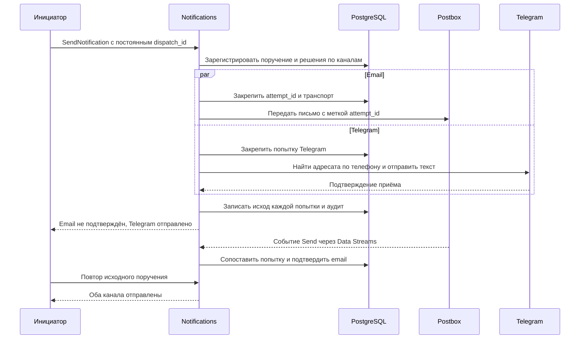

# Доставка и подтверждение уведомлений

## Обзор

Внутренний `notifications-service` принимает поручение для одного адресата, независимо обрабатывает выбранные каналы и возвращает по каждому результат передачи. PostgreSQL хранит достаточно данных, чтобы повторить ответ после сбоя и уточнить неизвестный исход. Контакты и текст для непосредственной отправки сервис получает от инициатора. Основания — [требования R1–R5](requirements.md) и [ADR 0008](../../architecture/adr/0008-notifications-service.md).

## Затронутые части

| Владелец | Ответственность |
|---|---|
| Notifications | NestJS-сервис, собственные PostgreSQL и миграции Prisma, gRPC, серверный флаг, адаптеры SMTP, Postbox и Telegram. Потребитель событий Postbox работает в составе сервиса. |
| Auth, задача 005/T4 | Передаёт сохранённый идентификатор отправки и абсолютный срок кода. Новое разрешённое письмо с тем же кодом получает новый идентификатор. Пользовательский ответ о постановке письма на доставку остаётся ответственностью Auth. |
| Partners, задача 006/T7 | Использует UUID приглашения и исходный срок, перед каждым обращением, которое может начать отправку, проверяет актуальность ссылки. При переходе по ссылке проверяет членство и состояние приглашения. |
| Общие пакеты и окружение | `@platform/contracts` распространяет proto и типы. Конфигурация, флаги, журнал и проверки здоровья используют пакеты платформы. Прямые вызовы идут по внутренней сети, браузерного маршрута и изменений UI нет. |

## Взаимодействие

Общий сценарий выполняет проверки до разделения на каналы. Глобальные ошибки — пустой текст, отсутствие любых контактов, пустой список каналов, неверный UUID или Timestamp. Иначе сервис проверяет каждый канал отдельно. Для email нужен синтаксически допустимый адрес, для Telegram — номер в международном формате E.164. Пробелы по краям контактов удаляются. Значение телефона с локальным префиксом сервис не дополняет предполагаемым кодом страны. Планируются независимые попытки только по запрошенным каналам. Для MAX до подключения адаптера, нулевого и неизвестного числового значения возвращается NOT_SENT с причиной unsupported_channel. Остальные каналы обрабатываются независимо. Каждое запрошенное значение встречается в результате один раз.

### Выполнение и повтор

1. По идентичности вызывающего сервиса и UUID найти или создать поручение под уникальным ограничением. Проверить отпечаток бизнес-полей. Зарегистрировать решение для каждого канала. Для доставки на один адрес результат другого канала не является условием начала.
2. Перед внешним вызовом короткой транзакцией под блокировкой строки канала записать UUID попытки, выбранный транспорт, состояние «начата» и аудит. Единственный победитель выполняет вызов после commit. Для SMTP это выполняется до передачи письма, для Telegram — до действия, способного отправить сообщение. Параллельный обработчик не вызывает транспорт по уже занятому каналу.
3. Бюджет вызова адаптера ограничен минимумом настроенного таймаута и оставшегося дедлайна gRPC с резервом на запись результата. Срок сообщения проверяется непосредственно перед началом передачи, включая время ожидания ограничителя Telegram. Если дедлайн исчерпан до начала и ничего не передано, фиксируется доказанный пропуск. После начала неопределённый результат отражается как UNCONFIRMED. Когда клиентский дедлайн всё же прервал сам RPC, клиент восстанавливает ответ по прежнему ключу.
4. Держать внешнюю операцию вне транзакции. Завершать попытку условным обновлением по attempt_id. Отложенное подтверждение может опередить синхронный ответ. Уже подтверждённый исход не затирается таймаутом. Перед возвратом читать согласованный снимок результатов и фиксировать выданный ответ в аудите.
5. Обычный повтор возвращает имеющиеся исходы. Канал, для которого не была начата ни одна попытка из-за падения процесса, можно закончить из данных повторного поручения с повторной проверкой срока. Если запись о начале уже зафиксирована, а процесс упал до подтверждения, канал остаётся UNCONFIRMED. Фоновое воспроизведение исходящих сообщений и автоматический переход на другой транспорт исключены.
6. Для явного повтора временного отказа инициатор указывает UUID завершившейся попытки в том же поручении. Под блокировкой канала сервис проверяет, что это последняя попытка, приём заведомо не состоялся и причина допускает повтор. Для одного такого UUID создаётся максимум один преемник. Повтор уже обработанной команды возвращает текущий результат. Для приглашения Partners перед выдачей разрешения на повтор заново проверяет ссылку. Сокращение окна между этой проверкой и фактической отправкой не заменяет проверку ссылки при принятии.

## Контракты

Внутренний метод `platform.notifications.v1.NotificationsService.SendNotification` добавляется в v1. Вход — UUID поручения, текст, контакты, список каналов, абсолютный срок и при необходимости UUID попыток для безопасного повтора. Срок обязателен для отправок Auth и Partners. Имя инициатора берётся из удостоверенного соединения. Выход — UUID и результаты каналов со статусом, безопасной причиной, UUID попытки при наличии и признаком допустимости повтора. В запросе и ответе используется перечисление `NotificationChannel`. Значения EMAIL и TELEGRAM поддерживаются на старте, MAX объявлен для следующей поставки. Новому каналу назначается новый номер в перечислении. Повторяющиеся каналы нормализуются в множество. [Контракт protobuf](../../../api/proto/notifications/v1/notifications.proto)

| Значение результата | Когда возвращается |
|---|---|
| SENT | SMTP-сервер, Postbox или Telegram подтвердил приём. Последующая доставка имеет собственный исход. |
| NOT_SENT | Канал пропущен или получен однозначный отказ. Причины: `missing_contact`, `invalid_contact`, `unsupported_channel`, `recipient_unavailable`, `expired`, `provider_rejected`, `temporary_rejection`. Только временный доказанный отказ с зарегистрированной попыткой может иметь retryable=true. |
| UNCONFIRMED | Начатая попытка пока не имеет достоверного результата. Причина `awaiting_confirmation`. Даже истечение срока не превращает этот результат в отказ. |

Префикс значений enum в proto — SUBMISSION_STATUS_. UNSPECIFIED никогда не выдаётся как бизнес-результат. При частичном или полном отказе отдельных каналов RPC успешен и содержит их результаты. Ошибки всего запроса — INVALID_ARGUMENT для некорректной формы, ABORTED при конфликте ключа или чужом идентификаторе повтора, UNAUTHENTICATED/PERMISSION_DENIED для ошибок доступа, UNAVAILABLE при невозможности надёжно зарегистрировать или прочитать результат. Добавление метода не меняет публичный OpenAPI.

Инициаторы импортируют клиент и тип запроса из `@platform/contracts/notifications/v1/notifications`. Оба ключа контактов обязательны при создании объекта TypeScript. Для письма передают `{ email: address, phone: undefined }`, для сообщения в Telegram — `{ email: undefined, phone: number }`, для обоих каналов — оба значения. Protobuf передаёт только заданные строки. Обработчик проверяет полученные значения по запрошенным каналам. Отсутствие контакта для выбранного канала обрабатывается по R1.6.

### Адаптеры и входящие события

- Email получает готовый текст и один адрес. Отправитель и нейтральная тема сервисного письма заданы в конфигурации. Собственный транспорт использует SMTP с проверкой TLS. Завершающий положительный ответ после DATA подтверждает приём; разрыв до получения этого ответа оставляет исход неизвестным, если передача могла состояться.
- Внешний адаптер вызывает Postbox SendEmail с конфигурацией событий и EmailTags с UUID попытки. Успех с MessageId сохраняет подтверждение сразу. Запрещены скрытые автоматические повторы библиотек при неоднозначном сетевом сбое. Потребитель читает настроенный доверенный поток Yandex Data Streams, сверяет источник, транспорт, метку попытки и известный MessageId, если он уже записан. В одной транзакции дедуплицирует eventId, сохраняет факт и применяет допустимый переход. Позиция чтения подтверждается после commit. Send подтверждает приём, Delivery и Bounce сохраняют отдельный исход доставки. Любое сопоставленное событие, однозначно доказывающее приём, допустимо и до получения Send. Запоздалое событие не обнуляет установленные факты. [SendEmail](https://yandex.cloud/ru/docs/postbox/aws-compatible-api/api-ref/send-email) · [События Postbox](https://yandex.cloud/ru/docs/postbox/concepts/notification)
- Telegram использует клиентский API выделенной учётной записи. Адаптер разрешает телефон только в доступного личного адресата и отправляет текст с постоянным для попытки random_id. Сервис соблюдает общий для учётной записи лимит разрешения номера между экземплярами через атомарное резервирование окна в PostgreSQL по идентификатору отправителя. Между началами двух запросов разрешения номера выдерживается минимум три секунды. При недостатке бюджета ожидания возвращается временный отказ до передачи сообщения. Если номер скрыт или чат недоступен, результат — NOT_SENT. Таймаут после начала отправки — UNCONFIRMED. Неоднозначный исход без достоверного свидетельства нельзя подтвердить по совпадению текста. [Поиск номера](https://core.telegram.org/method/contacts.resolvePhone) · [Отправка сообщения](https://core.telegram.org/method/messages.sendMessage)

## Данные

| Запись в собственной БД | Инвариант и назначение |
|---|---|
| Поручение | Уникальная пара «удостоверенный инициатор, dispatch_id», срок, версия ключа и HMAC канонического набора бизнес-полей. Каналы сортируются и устраняются повторы. Текст учитывается точно, список разрешений на повтор исключён из отпечатка. |
| Канал поручения | Уникальная пара «поручение, канал». Содержит результат проверки, текущую попытку и последнюю подтверждённую причину. |
| Попытка | UUID, канал, транспорт и конфигурация отправителя, время начала, исход передачи и отдельный исход доставки, ID провайдера и ссылка на предыдущую попытку. Уникальность преемника исключает двойной повтор. |
| Событие провайдера | Уникальны источник и eventId. Сохраняется только допустимый набор полей для корреляции. Несопоставимые или противоречащие доказанному исходу события учитываются для диагностики. |
| Журнал | Время, идентификаторы поручения и попытки, канал, операция, транспорт, безопасный результат. Решения и события журнала фиксируются в одной транзакции. |

Начальная миграция создаёт пустую базу. Сервис использует тело gRPC-запроса в памяти. Долговременное хранение текста, телефона, email и необработанных ответов транспорта для повтора не требуется. Старые ключи проверки HMAC должны оставаться доступны, пока существуют соответствующие поручения. Очистка не должна вновь открывать уже использованный ключ.

## Согласованность и сбои

Если PostgreSQL недоступна до фиксации попытки, внешний вызов запрещён. Если запись результата сорвалась после передачи, сохранённая попытка защищает от повторной отправки. После восстановления используется подтверждение провайдера, если оно доступно. Доказанный отказ в приёме и последующий отказ доставки принятого письма различаются. Если события источника недоступны, растут возраст неопределённых попыток и отставание читателя; почтовый транспорт не переключается автоматически. Потеря позиции читателя безопасна при воспроизведении событий.

## Feature toggles

Постоянный operational-флаг `notifications.email.external-provider` нужен для эксплуатационного выбора транспорта. Единственная точка проверки — выбор транспорта **новой** попытки email, через `@platform/feature-flags`. Включён — настроенный внешний адаптер (первым Postbox), выключен — собственный SMTP. При потере Unleash применяется кеш, при холодном старте — выключенное состояние. Уже начатая попытка и её события всегда принадлежат закреплённому транспорту. Флаг не публикуется во frontend. Реализация — T3. [Реестр](../../../deploy/unleash/flags.json)

## Безопасность

Использовать удостоверение сервиса по mTLS и список разрешённых инициаторов. Ключ из другого пространства инициаторов не даёт доступа к результату. Секреты SMTP, Postbox, Telegram-сессии и ключ HMAC выдаются сервису отдельно. Доступ читателя событий ограничивается нужным потоком. Проверки на стендах используют синтетические контакты. В ошибки, трассы, метки и журнал не попадают текст, адреса, ссылки, коды, Telegram peer и необработанные события.

## Наблюдаемость

Считать попытки по каналу, транспорту и исходу, пропуски, повторы без отправки, время ответа, возраст UNCONFIRMED, отставание потока и несопоставимые события. UUID допустим в журнале, но не в метках метрик. Алерты отслеживают рост неопределённых исходов, отказов и отставания читателя. Health по стандарту платформы проверяет процесс и доступ к БД; сбой транспорта виден отдельно от готовности остальных каналов.

## Риски и решения

До включения собственного транспорта требуется проверить реальный SMTP endpoint, TLS, полномочия и подтверждения после DATA. Пока у SMTP нет источника поздних подтверждений, потеря ответа может оставить результат неопределённым. Для Telegram нужны выделенная учётная запись, доступ к API и проверка разрешения номера в целевом окружении. Эти зависимости проверяются отдельно и не блокируют разработку ядра или адаптера Postbox. Принятие письма или сообщения не гарантирует прочтения.
